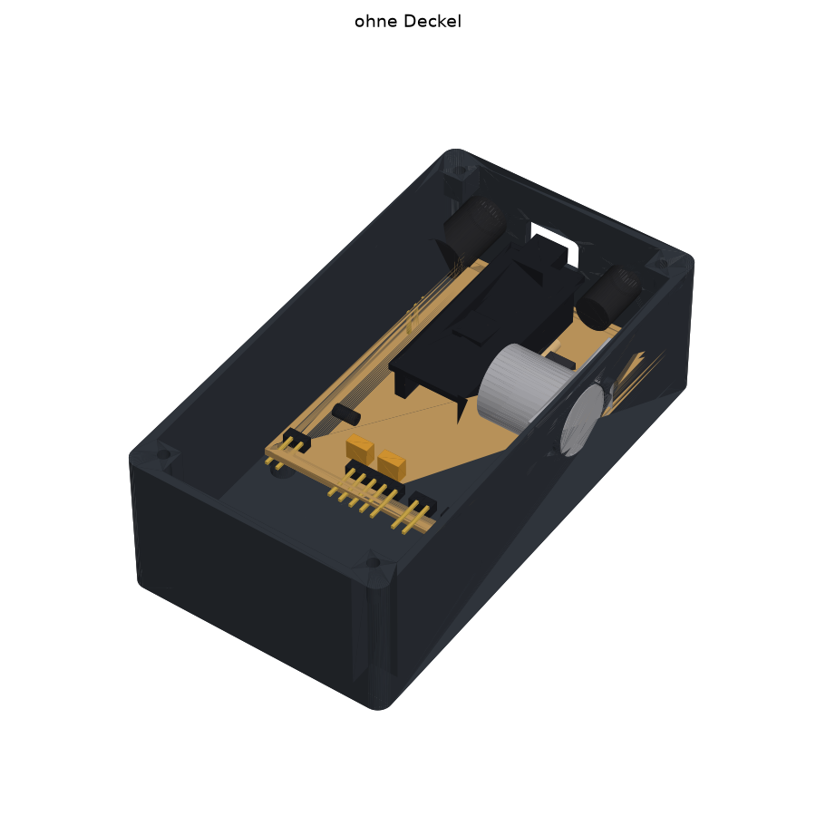

# Tap-Tempo Box

A small foot/desk box that turns a tapped tempo into **MIDI clock** and two **switched tempo outputs** (3.5 mm TRS, opto-isolated), with an OLED display and a rotary encoder for fine adjustment. Built around an ATmega328P (Arduino Nano pinout).



## Two hardware versions

| Folder | What it is | Status |
|---|---|---|
| [`nano-perfboard/`](nano-perfboard/) | Arduino Nano + optocouplers on a 5 × 7 cm perfboard, hand-soldered. Beginner-friendly build guide. Optional variant with a second, separate TRS output (D7/D6). | Designed, layout checked |
| [`smd-pcb/`](smd-pcb/) | Custom 2-layer PCB (52 × 70 mm) assembled by JLCPCB: ATmega328P-AU, CH340C, USB-C, regulator on board. Same pin mapping, so the same firmware runs. | Designed, ERC/DRC clean, not built yet |

Both share the same 3D-printed enclosure (60 × 110 × 36 mm, CadQuery), adapted per version.

## Pin mapping (both versions)

| Function | Arduino pin |
|---|---|
| TAP button (to GND, internal pull-up) | D5 |
| Start/Stop (encoder push button) | D4 |
| Encoder A / B | D3 / D2 |
| Switched output 1 → TRS tip (PC817, 220 Ω) | D10 |
| Switched output 2 → TRS ring (PC817, 220 Ω) | D9 |
| Perfboard 2-jack variant only: output 3 → TRS 2 tip / output 4 → TRS 2 ring | D7 / D6 |
| MIDI OUT (DIN pin 5 via 220 Ω) | D1 / TX |
| OLED SDA / SCL (SSD1306, I²C) | A4 / A5 |
| Power | 9 V barrel (center negative) → Schottky → VIN |

## Repository layout

```
firmware/          Arduino sketches (currently a hardware test sketch, needs U8g2)
nano-perfboard/
  kicad/           KiCad 10 schematic + PDF
  perfboard/       perfboard layout as code (perfboard.py), drawings, build guide generator
  mech/            CadQuery enclosure, renders, collision check, STL/STEP output, 3D viewer
  share/           standalone offline HTML: build guide and 3D viewer
smd-pcb/
  kicad/           generated KiCad project (schematic, routed PCB, ERC/DRC reports)
  fab/             JLCPCB files: Gerber zip, BOM, CPL
  mech/            enclosure adapted to the SMD board
  tools/           scripts that generate the whole KiCad project and fab files
```

## Quick links

- **3D printing:** `nano-perfboard/mech/out/{tray,lid}.stl` or `smd-pcb/mech/out/{tray,lid}.stl` (print the lid top side down)
- **Build guide (perfboard, German):** open `nano-perfboard/share/taptempo-bauanleitung.html` in a browser
- **3D viewer (offline):** `nano-perfboard/share/taptempo-3d.html`
- **Ordering the SMD board:** upload the three files in `smd-pcb/fab/` to JLCPCB, details in [`smd-pcb/README.md`](smd-pcb/README.md)

## Rebuilding

Enclosure (needs CadQuery):

```sh
cd nano-perfboard/mech
python -m venv .venv && .venv/bin/pip install cadquery matplotlib
.venv/bin/python enclosure.py      # -> out/*.stl, *.step, *.glb
.venv/bin/python render.py         # -> out/view_*.png
```

Perfboard drawings and guide (plain Python 3):

```sh
cd nano-perfboard/perfboard
python3 drawings.py && python3 build_guide.py
python3 drawings.py 2trs && python3 build_guide.py 2trs   # 2-jack variant
cd ../share && python3 build_standalone.py
```

SMD board (needs KiCad 10 with its `pcbnew` Python module and `kicad-cli`):

```sh
smd-pcb/tools/build.sh
```

## Language

The detailed build documentation is in German.

## License

MIT, see [LICENSE](LICENSE).
