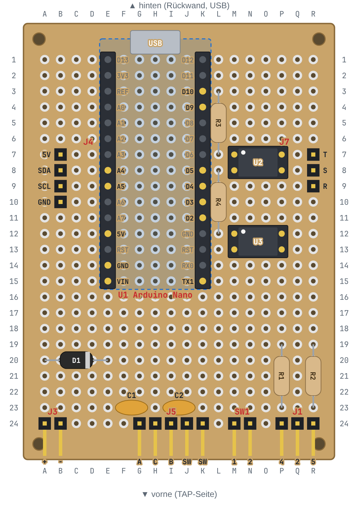
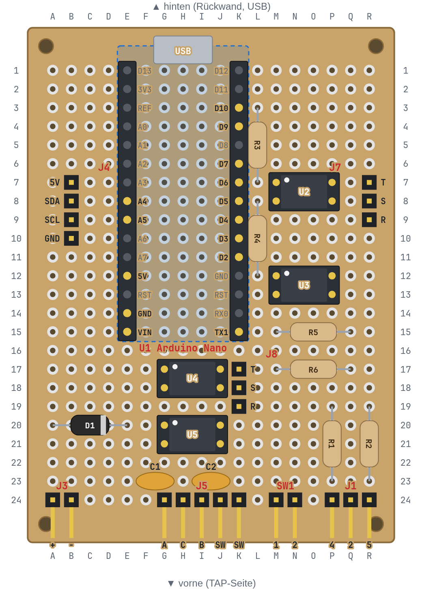

# Tap-Tempo-Box – Lochraster-Version (Arduino Nano)

| Pfad | Inhalt |
|---|---|
| `share/taptempo-bauanleitung.html` | Schritt-für-Schritt-Lötanleitung: Einkaufsliste, Lochplan, Brücken- und Drahtliste zum Abhaken, Prüfen, Test-Sketch. Im Browser öffnen. |
| `share/taptempo-3d.html` | 3D-Modell von Gehäuse und Platine (drehen, Deckel abheben) |
| `perfboard/component_side.*`, `perfboard/solder_side.*` | Bestückungsseite (von oben) und Lötseite (von unten, gespiegelt) als PNG zum Ausdrucken und als SVG |
| `perfboard/perfboard.py` | Lochraster-Layout als Code, mit Prüfung |
| `mech/out/tray.stl`, `mech/out/lid.stl` | 3D-Druck: Unterschale und Deckel (Deckel mit der Oberseite nach unten drucken) |
| `mech/out/*.step`, `mech/enclosure.py` | CAD-Modelle (CadQuery) |
| `kicad/` | Schaltplan (KiCad 10 und PDF) |
| `../firmware/taptempo_test/` | Arduino-Test-Sketch (braucht die Bibliothek U8g2) |

## Variante mit 2 Klinken

Gleiche Platine, plus eine zweite, eigene Klinkenbuchse (Klinke 2): zwei weitere Optokoppler U4/U5
mit R5/R6 an **D7 (Tip)** und **D6 (Ring)**, Stiftleiste J8 in K17–K19 (Tip, Sleeve, Ring).
Klinke 2 hat einen eigenen Sleeve und ist von Klinke 1 und von GND getrennt.
Alles andere bleibt an derselben Stelle. Ein eigenes Gehäuse gibt es dafür nicht: ins Standard-Gehäuse ein zweites 6-mm-Loch bohren.

| Pfad | Inhalt |
|---|---|
| `share/taptempo-bauanleitung-2klinken.html` | Lötanleitung für diese Variante |
| `perfboard/component_side_2trs.*`, `perfboard/solder_side_2trs.*` | Lochplan oben/unten |
| `perfboard/perfboard_2trs.py` | Layout-Daten und Prüfung gegen die Schaltung |

Neu erzeugen: im Ordner `perfboard/` `python3 drawings.py 2trs && python3 build_guide.py 2trs`
(ohne `2trs` für die normale Version). Der Test-Sketch schaltet D7/D6 mit; bei der Version mit einer Klinke sind die Pins einfach unbenutzt.

## Gehäuse

60 × 110 × 36 mm. Deckel: TAP-Taster (vorne), Drehgeber mit Taster = Start/Stop (Mitte), 0,96" OLED (hinten).
Rückwand: 9-V-Buchse, USB des Nano, 3,5-mm-Klinke. Rechts: MIDI-DIN.
Platine: Lochraster 5 × 7 cm (18 × 24 Löcher) auf 4 Abstandshaltern, M2.

Vor dem Druck mit den echten Teilen prüfen: TAP-Taster 16 mm / max. 22 mm tief,
Display 27 × 28 mm mit M2-Löchern 23,3 × 23,8 mm, MIDI-Buchse mit 22,4 mm Schraubabstand.
Die Löcher für 9-V- und Klinkenbuchse sind klein angelegt und lassen sich aufbohren.
