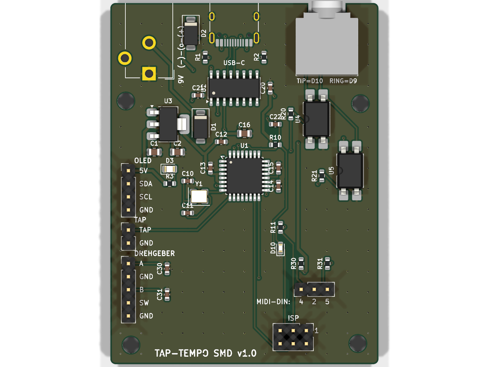

# Tap-Tempo-Box – SMD-Platine für JLCPCB

Eine 2-lagige Platine (52 × 70 mm), die JLCPCB herstellt **und mit den kleinen SMD-Bauteilen bestückt**.
Der Arduino Nano ist nicht mehr aufgesteckt, seine Schaltung sitzt direkt auf der Platine:
ATmega328P-AU, USB-Chip CH340C, USB-C-Buchse und 5-V-Regler.
Die Pinbelegung ist genau wie bei der Nano-Version. Die bisherige Firmware läuft deshalb unverändert,
in der Arduino-IDE wählst du einfach **„Arduino Nano“**.

Nicht auf der Platine sind OLED, Drehgeber, TAP-Taster und MIDI-DIN-Buchse. Sie sitzen im Gehäuse und werden
mit fertigen Dupont-Kabeln an Stiftleisten gesteckt. Auf der Hinterkante der Platine sitzen USB-C,
die 9-V-Buchse und die 3,5-mm-Klinke. Sie schauen durch die Rückwand.

Stand: 25.10.2026 · ERC 0 Fehler · DRC 0 Fehler · alle Netze geroutet · Schaltplan und Platine stimmen überein.



---

## 1. Was liegt wo?

| Pfad | Inhalt |
|---|---|
| `PLAN.md` | ursprünglicher Entwurfsplan (Spezifikation) |
| `kicad/taptempo-smd.kicad_pro/.kicad_sch/.kicad_pcb` | KiCad-10-Projekt: Schaltplan und geroutete Platine mit GND-Flächen oben und unten |
| `kicad/taptempo-smd-schaltplan.pdf` | Schaltplan als PDF zum Anschauen |
| `kicad/erc.rpt`, `kicad/drc.rpt` | Prüfberichte (0 Fehler) |
| **`fab/taptempo-smd_gerber.zip`** | **für JLCPCB:** Gerber- und Bohrdaten |
| **`fab/bom_jlcpcb.csv`** | **für JLCPCB:** Stückliste (Comment, Designator, Footprint, LCSC Part #) – nur die SMD-Teile, die JLCPCB bestückt |
| **`fab/cpl_jlcpcb.csv`** | **für JLCPCB:** Bestückungsdatei (Designator, Mid X, Mid Y, Layer, Rotation), Drehwinkel schon für JLCPCB korrigiert |
| `fab/tht_selbst_loeten.csv` | Teile zum Selbst-Einlöten (Buchsen, Stiftleisten) mit LCSC-Nummern |
| `fab/vorschau_oben.png`, `fab/vorschau_unten.png`, `fab/render_3d_oben.png` | Bilder der Platine |
| `mech/enclosure.py` | angepasstes Gehäuse (CadQuery): Rückwand-Löcher an den echten Buchsen, 4 Abstandshalter an den Platinenlöchern |
| `mech/out/tray.stl/.step`, `mech/out/lid.stl/.step` | **3D-Druck-Dateien** Unterteil und Deckel |
| `mech/out/assembly.step`, `mech/out/pcb.step` | Gesamtmodell bzw. Platine als 3D-Modell |
| `mech/collide.py`, `mech/out/collision_report.txt` | Kollisionsprüfung (Ergebnis: keine Kollisionen, alle Stecker passen durch die Löcher) |
| `mech/out/view_*.png` | Ansichten Platine im Gehäuse |
| `tools/` | Skripte, die alles erzeugen (siehe Abschnitt 8) |

---

## 2. Die Schaltung in Kürze

| Funktion | Bauteil | ATmega-Pin (Arduino) |
|---|---|---|
| TAP-Taster (gegen GND, interner Pull-up) | Stecker J6 | D5 |
| Start/Stop (Taster im Drehgeber) | Stecker J5 „SW“ | D4 |
| Drehgeber A / B (je 100 nF gegen GND auf der Platine) | Stecker J5 | D3 / D2 |
| Schaltausgang 1 → Klinke **Tip** | Optokoppler U4 (220 Ω) | D10 |
| Schaltausgang 2 → Klinke **Ring** | Optokoppler U5 (220 Ω) | D9 |
| MIDI OUT: DIN-Pin 5 über 220 Ω an TX, DIN-Pin 4 über 220 Ω an +5 V, DIN-Pin 2 an GND | Stecker J7 | D1/TX |
| OLED SDA / SCL | Stecker J4 | A4 / A5 |
| Status-LED „L“ (rot) | D10 | D13 |

- **Versorgung:** 9 V über die Hohlbuchse (5,5/2,1 mm, **Minus innen** wie bei Boss-Netzteilen) →
  Verpolschutzdiode SS14 → Spannungsregler AMS1117-5.0 → +5 V.
  Alternativ USB-C: VBUS → Diode SS14 → +5 V. Die beiden Quellen speisen sich nicht gegenseitig.
  Die grüne LED zeigt an, dass Strom da ist.
- **USB:** CH340C (braucht keinen Quarz). Auto-Reset beim Hochladen über DTR → 100 nF → RESET, genau wie beim Nano.
- **Klinke:** Tip und Ring sind die Kollektoren der Optokoppler, Sleeve sind beide Emitter.
  Die Klinke ist galvanisch getrennt und **nicht** mit GND verbunden.
- **ISP-Stecker J8** (2 × 3): nur zum einmaligen Brennen des Bootloaders, siehe Abschnitt 5.

### Stecker auf der Platine (Beschriftung steht auf der Platine)

| Stecker | Pins (von Pin 1 = eckiges Pad) | Kabel zu |
|---|---|---|
| J4 OLED | 5V, SDA, SCL, GND | OLED-Modul. **Achtung:** viele Module haben die Reihenfolge GND-VCC-SCL-SDA. Kabel einzeln nach Beschriftung stecken. |
| J6 TAP | TAP, GND | TAP-Fußtaster |
| J5 DREHGEBER | A, GND, B, SW, GND | Drehgeber: A, Mitte C, B, die beiden Taster-Pins |
| J7 MIDI-DIN | 4, 2, 5 | DIN-Buchse Pin 4, Pin 2, Pin 5 (Lötseite der Buchse ansehen) |
| J8 ISP | Standard-AVR-ISP-6-Pin (1 = MISO) | USBasp oder Arduino als ISP |

---

## 3. Bauteile (BOM)

**JLCPCB bestückt 34 SMD-Teile (17 BOM-Zeilen, 138 Lötstellen)**, alle auf der Oberseite.
Alle LCSC-Nummern wurden am 25.10.2026 in der JLCPCB-Teilebibliothek geprüft (Lager, Basic/Extended, Preis).

| Teil | Designator | LCSC | Typ | Lager |
|---|---|---|---|---|
| ATmega328P-AU (TQFP-32) | U1 | C14877 | **Preferred Extended** (keine Rüstgebühr) | 42 180 |
| CH340C (SOP-16) | U2 | C84681 | **Extended** | 116 810 |
| USB-C HRO TYPE-C-31-M-12 | J1 | C165948 | **Extended** | 323 957 |
| PC817C SMD (Goodwork) | U4, U5 | C3025164 | **Extended** | 1 465 857 |
| AMS1117-5.0 (SOT-223) | U3 | C6187 | Basic | 147 984 |
| SS14 (SMA) | D1, D2 | C2480 | Basic | > 2 Mio. |
| Quarz 16 MHz 3225 (9 pF Last) | Y1 | C13738 | Basic | 192 633 |
| 12 pF C0G 0603 | C10, C11 | C38523 | Basic | 645 360 |
| 100 nF 0603 | 9 × | C14663 | Basic | 44 Mio. |
| 10 µF 25 V 0805 | C1, C16 | C15850 | Basic | 9 Mio. |
| 22 µF 0805 | C2 | C45783 | Basic | 4 Mio. |
| 220 Ω / 1 kΩ / 10 kΩ / 5,1 kΩ 0603 | R… | C22962 / C21190 / C25804 / C23186 | Basic | Millionen |
| LED grün 0805 (Power) | D3 | C2297 | Basic | 2,4 Mio. |
| LED rot 0603 („L“, D13) | D10 | C2286 | Basic | 7,8 Mio. |

→ **3 Extended-Sorten mit Rüstgebühr** (CH340C, USB-C, PC817C) und 1 Preferred-Extended-Sorte (ATmega) ohne Gebühr.
Das Ziel „≤ 5 Extended-Sorten“ ist erfüllt.

**Selbst einlöten** (Durchsteckteile, `fab/tht_selbst_loeten.csv`, 26 Lötstellen pro Platine):

| Teil | Designator | LCSC | Lager |
|---|---|---|---|
| Hohlbuchse CUI PJ-102AH (5,5/2,1 mm) | J2 | C3096093 | 1 723 |
| 3,5-mm-Stereoklinke CUI SJ1-3523N | J3 | C20182914 | 469 (eher knapp) |
| Stiftleiste 1×4 / 1×5 / 1×2 / 1×3, 2,54 mm | J4 / J5 / J6 / J7 | C2691448 / C492404 / C492401 / C2937625 | viele |
| Stiftleiste 2×3, 2,54 mm (ISP) | J8 | C65114 | 44 583 |

Die Footprints passen genau zu diesen Buchsen. Andere Hohlbuchsen oder Klinken haben meist andere Lochbilder.

---

## 4. Bestellen bei JLCPCB – Schritt für Schritt

1. Auf **jlcpcb.com** einloggen (Account anlegen machst du selbst) → **„Order now“**.
2. **„Add gerber file“** → `fab/taptempo-smd_gerber.zip` hochladen. JLCPCB erkennt 2 Lagen und 52 × 70 mm.
3. Platinen-Optionen (alles andere auf Standard lassen):
   - Base Material **FR-4**, Layers **2**, PCB Qty **5**, Thickness **1.6 mm**
   - PCB Color **Green** (billigste Farbe), Surface Finish **HASL (with lead)** oder „LeadFree HASL“
   - „Remove Order Number“: kostenlos „Yes/Specify a location“ wählen oder einfach so lassen.
     Dann druckt JLCPCB eine kleine Nummer irgendwo auf die Platine.
4. Ganz unten **„PCB Assembly“** einschalten:
   - PCBA Type **Economic**, Assembly Side **Top Side**
   - **PCBA Qty: 2** (oder 5). Du kannst 5 Platinen bestellen und nur 2 bestücken lassen. Das Minimum ist 2.
   - „Tooling holes“: **Added by JLCPCB** (das ist ok).
   - „Confirm Parts Placement“: **Yes** empfohlen (ca. 0,45 $). Dann schickt dir JLCPCB vor der Fertigung ein Foto der Bestückung zur Freigabe.
5. **„NEXT“** → Vorschau der Platine → **„NEXT“**.
6. **BOM** = `fab/bom_jlcpcb.csv` und **CPL** = `fab/cpl_jlcpcb.csv` hochladen → „Process BOM & CPL“.
7. Teileliste prüfen: Alle 17 Zeilen müssen ein Häkchen und ein gefundenes Teil haben.
   Die LCSC-Nummer steht in jeder Zeile.
   Meldet JLCPCB ein Teil als „out of stock“, nimm über „Select“ eine gleichwertige Alternative.
   Für Widerstände und Kondensatoren gilt: gleicher Wert und gleiche Größe, möglichst „Basic“.
8. **Bestückungsvorschau genau ansehen** (wichtigster Schritt, hier passieren die meisten Fehler):
   Jedes Bauteil hat einen roten Punkt für Pin 1 bzw. die Kathode. Prüfe:
   - **U1 ATmega:** der Punkt auf dem Chip muss auf der Platinenmarkierung (kleines Dreieck/„1“ an der Ecke, Richtung C13) liegen.
   - **U2 CH340C:** Pin-1-Punkt beim kleinen Dreieck neben C21.
   - **U3 AMS1117:** die breite Lasche liegt rechts (Richtung D1), die 3 schmalen Beine links.
   - **U4/U5 Optokoppler:** Punkt bei Pin 1 (Kerbe im Silkscreen-Umriss).
   - **D1, D2 (SS14):** Kathodenstrich auf der Seite der Platinenmarkierung.
   - **D3, D10 (LEDs):** Kathode wie auf der Platine markiert.
   - **J1 USB-C:** die Öffnung zeigt zur Platinenkante (nach hinten).

   Die Drehwinkel in der CPL wurden schon korrigiert: Für jedes Bauteil wurde der KiCad-Footprint mit dem
   JLCPCB-/EasyEDA-Footprint verglichen (U1 +270°, U2 +270°, U3 +180°, LEDs +180°).
   Steht trotzdem etwas verdreht da, kannst du es in der Vorschau drehen oder in `cpl_jlcpcb.csv` die Spalte „Rotation“ ändern.
9. **„NEXT“** → Preis prüfen (siehe Abschnitt 6) → „Save to cart“ → bezahlen.
   Versand: „Global Standard Direct Line“ ist am günstigsten (ca. 9–13 Tage).
   Die 19 % Mehrwertsteuer berechnet JLCPCB schon an der Kasse (IOSS), beim Zusteller zahlst du dann nichts mehr.
10. **Buchsen und Stiftleisten** gleich mitbestellen: bei **lcsc.com** die LCSC-Nummern aus
    `fab/tht_selbst_loeten.csv` in den Warenkorb legen, 5 Sätze.
    An der LCSC-Kasse kannst du laut LCSC-FAQ „Combine with JLCPCB order“ wählen, dann kommt alles in einem Paket.
    Bei JLCPCB selbst kann man Teile **nicht** einzeln mitschicken lassen.

**Selbst einlöten** (einfache Durchsteck-Lötstellen, gut für Anfänger): zuerst die Stiftleisten, dann Klinke und Hohlbuchse.
Die Teile kommen von oben in die Platine, gelötet wird unten.
Die Klinke hängt mit ihrer vorderen Nase über die Aussparung an der Platinenkante, das ist so gewollt.

---

## 5. Bootloader brennen (einmalig, JLCPCB liefert den ATmega leer)

Ohne Bootloader kann man über USB nichts hochladen. Du brauchst **einmal** einen ISP-Programmer, dafür gibt es zwei Wege.
Während des Brennens nichts anderes anschließen (kein Netzteil, kein USB an der Box).
Die Box wird über den ISP-Stecker mit 5 V versorgt.

### Weg A: zweiter Arduino (Uno/Nano) als Programmer („Arduino as ISP“)

1. In der Arduino-IDE: *Datei → Beispiele → 11.ArduinoISP → ArduinoISP* öffnen und **auf den Hilfs-Arduino** hochladen
   (Board „Arduino Uno“ bzw. „Nano“).
2. 6 Dupont-Kabel vom Hilfs-Arduino zum ISP-Stecker **J8** der Box (Pin 1 ist mit „1“ markiert, eckiges Pad):

   | Hilfs-Arduino | J8-Pin | Signal |
   |---|---|---|
   | D12 | 1 | MISO |
   | 5V | 2 | VCC |
   | D13 | 3 | SCK |
   | D11 | 4 | MOSI |
   | **D10** | 5 | RESET |
   | GND | 6 | GND |

   Beim Uno zusätzlich einen 10-µF-Elko zwischen RESET und GND des **Uno** stecken (Minus an GND),
   damit er sich nicht selbst zurücksetzt.
3. In der IDE: *Werkzeuge → Board → **Arduino Nano***, *Prozessor → **ATmega328P*** (nicht „Old Bootloader“),
   *Programmer → **Arduino as ISP***.
4. *Werkzeuge → **Bootloader brennen***. Nach ca. 10–20 s erscheint „Bootloader erfolgreich gebrannt“.
   Dabei werden auch die Fuses für den 16-MHz-Quarz gesetzt.

### Weg B: USBasp (ca. 5 € im Netz)

1. Am USBasp den Jumper auf **5 V** stellen. Das 6-polige Flachkabel direkt auf **J8** stecken
   (rote Ader bzw. Nase auf Pin 1 = „1“).
   Liegt nur ein 10-poliges Kabel bei, brauchst du einen 10→6-Adapter.
2. Arduino-IDE: Board **Arduino Nano**, Prozessor **ATmega328P**, Programmer **USBasp** → *Bootloader brennen*.
   (Unter Windows evtl. Treiber mit „Zadig“ installieren, unter Linux eine udev-Regel.)

### Danach: Firmware über USB-C hochladen

- ISP-Kabel abziehen, Box per USB-C an den Rechner. Die grüne LED leuchtet, die rote „L“-LED blinkt kurz (Bootloader).
- Board **Arduino Nano**, Prozessor **ATmega328P**, den neuen Port wählen (Linux `/dev/ttyUSB0`, Windows COMx;
  ältere Windows-Versionen brauchen evtl. den **CH340-Treiber**) → bisherigen Sketch hochladen. Fertig.

---

## 6. Kosten (Schätzung, Preise vom 25.10.2026)

Grundlage: JLCPCB-Preisseiten (PCB „ab 2 $ für 5 Stück“, grün; PCBA Economic: Einrichtung ca. 8 $,
Schablone ca. 1,50 $, 0,0016 $ pro Lötstelle, ca. 3 $ Rüstgebühr pro Extended-Sorte, Preferred Extended und Basic ohne Gebühr)
und die Teilepreise aus der JLCPCB-Bibliothek. Der Endpreis steht erst im JLCPCB-Angebot, dort bitte vergleichen.

**Echte Zahlen dieses Designs:** 34 SMD-Teile, **138 SMD-Lötstellen**, **3 Extended-Sorten mit Gebühr** (+1 Preferred),
Teilekosten ca. **3,90 $ pro Platine** (davon ATmega 2,31 $).

| Posten | 5 PCBs, **2 bestückt** | 5 PCBs, **5 bestückt** |
|---|---|---|
| Platinen (5 Stück, grün) | 2,00 $ | 2,00 $ |
| PCBA Einrichtung (Economic) | 8,00 $ | 8,00 $ |
| Schablone | 1,50 $ | 1,50 $ |
| Rüstgebühr 3 Extended-Sorten × 3 $ | 9,00 $ | 9,00 $ |
| Lötstellen 138 × 0,0016 $ pro Platine | 0,44 $ | 1,10 $ |
| Bauteile (inkl. Mindestmengen/Ausschuss, ca.) | 8,50 $ | 20,00 $ |
| „Confirm parts placement“ (optional) | 0,45 $ | 0,45 $ |
| **Zwischensumme** | **≈ 30 $** | **≈ 42 $** |
| Versand nach DE (Global Standard Direct, ca.) | ≈ 12 $ | ≈ 12 $ |
| **Summe ohne MwSt.** | **≈ 42 $** | **≈ 54 $** |
| + 19 % MwSt. (wird an der Kasse berechnet) | ≈ 8 $ | ≈ 10 $ |
| **Gesamt** | **≈ 50 $ ≈ 45 €** | **≈ 64 $ ≈ 58 €** |

Dazu kommen:
- **Buchsen + Stiftleisten** (selbst löten): ca. 2,70 $ pro Satz, 5 Sätze ≈ 14 $ zzgl. Versand von LCSC
  (zusammen mit dem JLCPCB-Paket günstiger, sonst ca. 10–20 $).
  Alternativ passende Teile aus dem eigenen Fundus: Stiftleisten sind Standard, Klinke und Hohlbuchse müssen aber genau diese Typen sein.
- Seit 1.7.2026 erhebt die EU auf Pakete unter 150 € pauschal **3 € Zoll pro Warenart**.
  Ob JLCPCB das an der Kasse mitkassiert, war nicht zu klären. Rechne mit bis zu 3–6 €.
- Optional: JLCPCB lötet auch die Durchsteckteile (3,58 $ pro Auftrag + 0,0164 $ × 26 Lötstellen pro Platine
  + vermutlich Rüstgebühren für die Buchsen). Für 2 Boxen lohnt sich das nicht. Die 26 Lötstellen schafft man selbst.
- Euro-Werte mit ca. 0,90 €/$ gerechnet, Kurs bitte prüfen.

---

## 7. Gehäuse (3D-Druck)

- `mech/out/tray.stl` (Unterteil) und `mech/out/lid.stl` (Deckel) drucken. Außenmaße 60 × 110 × 36 mm wie bisher.
- **Neu:** Rückwand-Löcher an den echten Buchsen-Positionen:

  | Buchse | x (von links, von vorne gesehen) | Höhe z | Loch |
  |---|---|---|---|
  | 9 V Hohlbuchse | 11,5 mm | 15,1 mm | Ø 10,5 mm |
  | USB-C | 28,0 mm | 10,2 mm | 13 × 7,5 mm |
  | 3,5-mm-Klinke | 46,0 mm | 11,1 mm | Ø 7 mm |

  Die Löcher sind so groß, dass die Umspritzung der Stecker durch die 2-mm-Wand passt und die Stecker ganz einrasten.
- **4 Abstandshalter** (Ø 6,5 mm, 5 mm hoch) an den Platinenlöchern bei (8 / 41,2), (52 / 41,5), (7 / 88,5), (52,5 / 88).
  Befestigung mit 4 × **M3-Blechschrauben (Kunststoffschrauben) 3 × 8 mm**, Vorbohrung 2,5 mm ist schon drin.
- Einbau-Reihenfolge: **zuerst die Platine** von oben einlegen (Buchsen an die Rückwand) und festschrauben,
  **danach die MIDI-DIN-Buchse** in die rechte Wand schrauben. Ihr Körper ragt über den rechten Platinenrand,
  mit eingebauter DIN-Buchse lässt sich die Platine nicht mehr einlegen.
  Dann die Dupont-Kabel stecken und den Deckel aufsetzen.
- Kollisionsprüfung (`mech/out/collision_report.txt`): keine Kollision zwischen Platine, Gehäuse, Drehgeber, OLED,
  TAP-Taster und DIN-Buchse. Alle drei Stecker passen durch ihre Löcher.
  Die Dupont-Stecker auf den Stiftleisten reichen bis z = 31 mm, der Deckel beginnt bei 34 mm.

---

## 8. Neu erzeugen (für später)

Alles wird aus `tools/design.py` erzeugt (Bauteile, Netze, LCSC-Nummern, Positionen):

```bash
cd tools
./build.sh            # Projekt + Schaltplan + Platine + Freerouting + GND-Flächen + ERC/DRC + fab/-Dateien
python3 jlc_rotation.py   # nur nötig, wenn Bauteile/LCSC-Nummern geändert werden (Drehwinkel für JLCPCB)
python3 lcsc_check.py C14877 "PC817"   # Teil in der JLCPCB-Bibliothek nachschlagen
cd ../mech
kicad-cli pcb export step --subst-models -f -o out/pcb.step ../kicad/taptempo-smd.kicad_pcb
../../nano-perfboard/mech/.venv/bin/python enclosure.py && ../../nano-perfboard/mech/.venv/bin/python collide.py
```

Freerouting routet bei jedem Lauf etwas anders. Nach `build.sh` immer auf „0 violations“ achten.

---

## 9. Offene Punkte / bitte prüfen

1. **Nicht in echt getestet:** Schaltplan, ERC, DRC und Mechanik sind geprüft, ein Prototyp existiert noch nicht.
   Für die erste Bestellung deshalb nur 2 Platinen bestücken lassen.
2. **Bestückungsvorschau bei JLCPCB** (Abschnitt 4, Schritt 8) gründlich prüfen. Die Drehwinkel sind berechnet, nicht praktisch erprobt.
3. **Hohlbuchse PJ-102AH:** KiCad hat kein 3D-Modell dafür.
   Die Achshöhe von 6,5 mm über der Platine ist aus dem Datenblatt geschätzt, deshalb das großzügige Ø-10,5-Loch.
   Nach dem Druck kurz anhalten, notfalls das Loch etwas aufbohren.
   Für die USB-C-Buchse gibt es ebenfalls kein Modell, sie ist als Quader nach Datenblatt modelliert.
4. **Lagerbestand der Klinke** SJ1-3523N (C20182914) ist mit 469 Stück eher knapp. Bei Bedarf vor der Bestellung nachsehen.
5. **OLED-Pinreihenfolge** am Modul prüfen (oft GND-VCC-SCL-SDA). Auf der Platine steht 5V-SDA-SCL-GND.
6. Kein Polyfuse und kein ESD-Schutz an USB. Beides wären weitere Extended-Teile mit Gebühr.
   Für ein Hobbygerät ist das unkritisch, der PC-USB-Port hat eine eigene Strombegrenzung.
7. Bei USB-Versorgung liegen nach der Diode ca. 4,6 V an statt 5 V. Das ist wie beim Original-Nano und für 16 MHz ausreichend.
8. Die EU-Zollpauschale von 3 € und der exakte JLCPCB-Endpreis sind nicht verifiziert. Siehe das Angebot an der Kasse.
9. Die Leiterbahnen hat der Autorouter verlegt. Sie sind elektrisch in Ordnung (DRC 0), aber nicht schön.
   USB D+/D− sind sehr kurz (CH340C direkt hinter der Buchse), bei 12 Mbit/s ist das unkritisch.

### Abweichungen vom PLAN.md (mit Grund)

- **Quarz-Lastkondensatoren 12 pF statt 22 pF:** Der einzige Basic-Quarz 16 MHz 3225 (C13738) ist für 9 pF Last spezifiziert.
  Daraus folgt 2 × (9 pF − ca. 3 pF Streukapazität) ≈ 12 pF.
- **SS14 für beide Dioden** (der Plan erlaubte SS14/SS34): 1 A reicht weit und spart eine BOM-Zeile.
- **Keine Polyfuse** (im Plan optional): Es gibt keine Basic-Variante, sie wäre die 4. Extended-Sorte mit Gebühr.
- **Power-LED grün in 0805** (C2297): Eine grüne 0603-LED gibt es nicht als Basic-Teil.
- **Platinengröße 52 × 70 mm** statt ideal ≤ 50 × 70: Die drei Buchsen nebeneinander brauchen die Breite.
  Das Maximum von 54 × 75 ist eingehalten, und unter 100 × 100 mm ändert sich der Preis nicht.
- **Aussparung in der Hinterkante** (7,2 × 2,2 mm) für die Klinke: Die Nase der SJ1-3523N hängt über die Kante
  und reicht 0,5 mm unter die Platinenoberfläche.
- **Abstandshalter Ø 6,5 mm für M3-Blechschrauben** (vorher M2 bei der Lochraster-Version).
